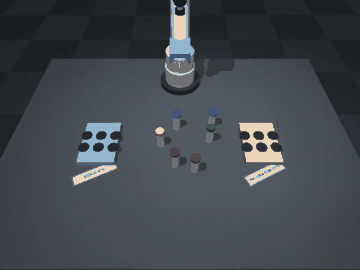
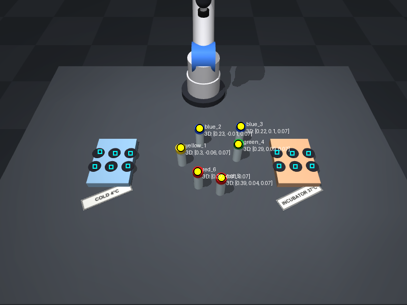
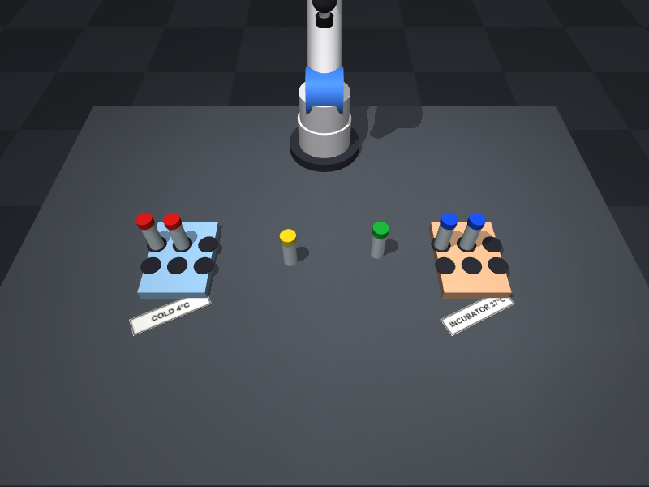
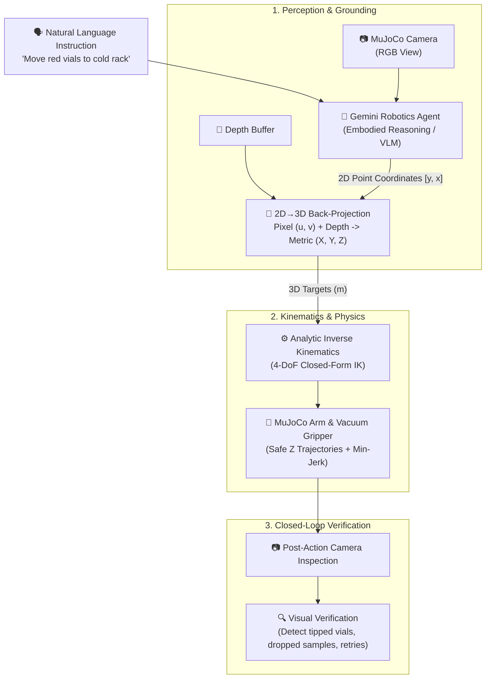

# 🧪 Gemini Lab Robot

> **Build an AI-powered Self-Driving Lab Assistant on Your Laptop**  
> *Google Gemini Robotics-ER + MuJoCo Physics, Vibe-Coded with Google Antigravity.*  
> **Zero CUDA Required • Apple Silicon (M1–M5) / Intel / Windows / Linux Native • 100% Open-Source**



---

## 🌟 Overview

The field of **AI for Science** is rapidly advancing toward **Self-Driving Laboratories (SDLs)**—automated environments where artificial intelligence designs experiments, robotic arms handle physical samples, and closed-loop feedback drives scientific discoveries in chemistry, biology, and materials science.

However, robotics often carries a steep barrier to entry: expensive robotic arms, complex ROS drivers, and high-performance CUDA computing clusters.

**Gemini Lab Robot** shows that you don't need any of that to start innovating in physical AI:
* 🧠 **The Brain**: **Google Gemini Robotics-ER** (or Gemini Flash) provides spatial reasoning, pointing coordinates, task planning, and visual verification.
* 🦾 **The Body**: **Google DeepMind's MuJoCo** provides contact-rich physics, simulated cameras, and realistic sample handling—running on everyday laptop CPUs.
* ⚡ **The Glue**: A lightweight 2D-to-3D projection bridge translating vision-language coordinates into real-world Cartesian trajectories.
* 💻 **Accessible**: Tested on base Apple Silicon (MacBook Pro M5 / Mac mini M4) with zero GPU configuration.

---

## 📸 Key Capabilities

| Step 1: Visual Pointing & Grounding | Step 3: Natural Language Autonomous Sorting |
|:---:|:---:|
|  |  |
| *Gemini points to sample vials and empty rack slots; depth back-projects 2D pixels into 3D metric targets.* | *Autonomous multi-step execution: "Transfer all red sample vials to COLD 4°C, and blue vials to INCUBATOR 37°C."* |

---

## 🏗️ Architecture: Brain vs. Body



---

## 🚀 5-Minute Quickstart

### Prerequisites
* Python 3.10 to 3.13
* `uv` (recommended) or standard `pip` / `venv`
* No GPU or CUDA installation required!

### 1. Clone & Install
```bash
git clone https://github.com/htcrefactor/gemini-lab-robot.git
cd gemini-lab-robot

# Using uv (fastest):
uv sync

# Or using standard pip:
python3 -m venv .venv
source .venv/bin/activate
pip install -e .
```

### 2. Configure Your API Key (No Terminal Exports Required)
Open `config.json` in your favorite editor and paste your free key from [Google AI Studio](https://aistudio.google.com/app/apikey):
```json
{
  "gemini_api_key": "your-api-key-here",
  "model": "gemini-robotics-er-2-preview"
}
```
> 💡 **No API key? No problem!**  
> If `config.json` contains the placeholder text `"your-api-key-here"`, the demo automatically runs in **high-fidelity offline mock mode**, allowing anyone to explore the entire simulation and control loop completely free.
>
> 🔒 **Git tip for contributors**: To avoid accidentally committing your local API key back to git, run:
> ```bash
> git update-index --assume-unchanged config.json
> ```

### 3. Run the Walkthrough
```bash
# Run the complete end-to-end demo and generate outputs/gemini_lab_robot_demo.mp4
python demo.py --all
```

---

## 🛠️ Step-by-Step Workshop Walkthrough

Follow along step-by-step just like in our **APAC AI for Science DevFest 2026** presentation:

### Step 0: Inspecting the Simulated Lab Bench
Spins up the MuJoCo lab environment with custom racks (`COLD 4°C`, `INCUBATOR 37°C`), sample vials with liquid color-coding, and dual camera perspectives.
```bash
python demo.py --step 0
```
Outputs: `outputs/step0_bench_cam.png`, `outputs/step0_top_cam.png`

### Step 1: Visual Pointing & 3D Spatial Grounding
The vision model inspects the scene and returns normalized 2D pointing coordinates `[y, x]` for every vial cap and empty rack well. The grounding pipeline back-projects these into 3D world coordinates with sub-millimeter accuracy.
```bash
python demo.py --step 1
```
Outputs: `outputs/step1_grounding_annotated.png`

### Step 2: Cartesian Pick-and-Place Primitives
Executes a smooth min-jerk trajectory with the 4-DoF robotic arm. The end-effector descends onto the vial cap, engages the vacuum seal, lifts to a safe travel height (`SAFE_Z`), and places it into the target rack.
```bash
python demo.py --step 2
```
Outputs: `outputs/step2_after_pick_place.png`

### Step 3: Natural Language Autonomous Sample Sorting
Give the agent a complex instruction:
> *"Transfer all red sample vials to the COLD 4°C rack and all blue vials to INCUBATOR 37°C."*

The model reasons through the scene, generates an action sequence, and executes multi-step pick-and-place routines.
```bash
python demo.py --step 3
```
Outputs: `outputs/step3_sorted_bench.png`

### Step 4: Disturbance Injection & Self-Correction
What happens when experiments in the real world go wrong? In this step, we inject a physical disturbance (bumping the bench, knocking a vial out of position). The agent performs visual verification, flags the displaced vial, and executes an automated recovery sequence.
```bash
python demo.py --step 4
```
Outputs: `outputs/step4_disturbed.png`, `outputs/step4_recovered.png`

---

## 📦 Project Structure

```text
├── demo.py               # Interactive step-by-step CLI walkthrough
├── pyproject.toml        # Minimal dependencies (mujoco, google-genai, pillow, imageio)
├── lab_robot/
│   ├── __init__.py
│   ├── scene.py          # Procedural MuJoCo MJCF generation & high-res label textures
│   ├── sim.py            # Physics environment, analytic IK, vacuum gripper, cameras
│   └── agent.py          # Gemini Robotics-ER perception, grounding & planning
└── outputs/              # Generated renders, annotated images, and demo MP4 video
```

---

## 🔬 Road to Real Hardware (Sim-to-Real)

The kinematics and coordinate frames in this project are designed to map directly onto low-cost open-source robotic arms:
* **Hardware Target**: **SO-101 / SO-ARM100** (~$200 3D-printed 6-DOF arm via Hugging Face LeRobot).
* **Sensor**: Standard USB webcam or RealSense depth camera mounted over the bench.
* **Controller**: The same Python tool-calling interface can dispatch serial servo commands via Feetech STS3215 drivers.

---

## 📜 Citation & Credits

Created for the **APAC AI for Science DevFest 2026** organized by Google Developer Groups (GDG) AI for Science.

* **Physics Engine**: [MuJoCo (Google DeepMind)](https://github.com/google-deepmind/mujoco)
* **Embodied AI**: [Google Gemini Robotics](https://ai.google.dev/gemini-api/docs/robotics-overview)
* **Development Environment**: [Google Antigravity](https://antigravity.google)
* **License**: Apache 2.0
